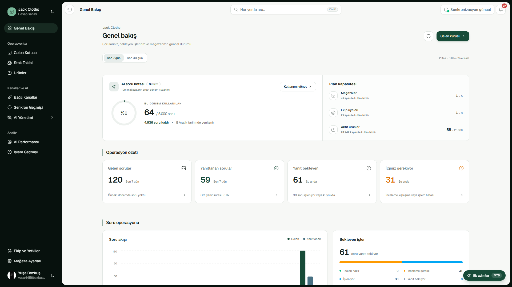
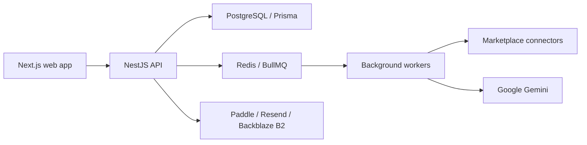
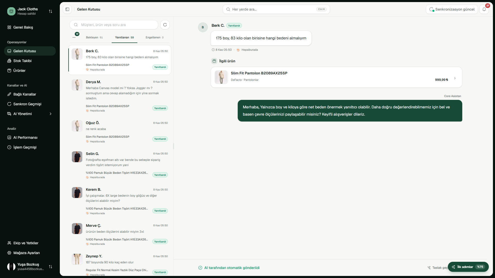
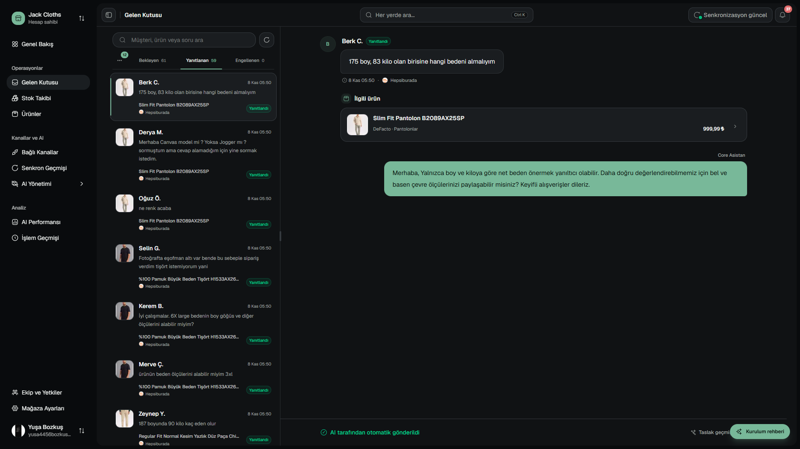
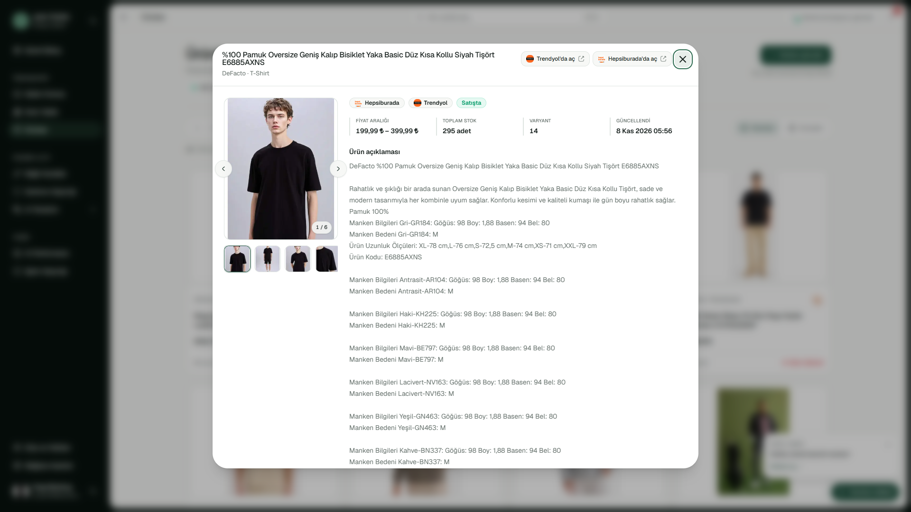
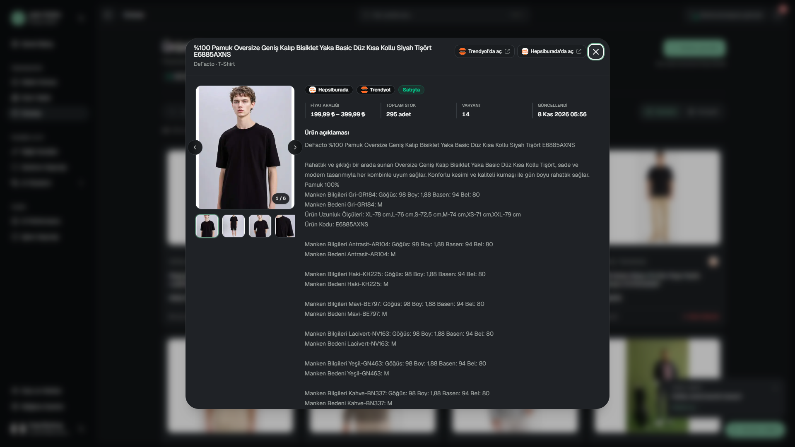

# Core Asistan

**AI tools for customer questions and marketplace operations.**

Core Asistan is a full-stack application that helps online sellers manage customer questions, products, stock, and store operations in one place. It combines a shared inbox with AI answer drafts, store knowledge, team access, and subscription management.

[Features](#features) · [AI workflow](#ai-workflow) · [Architecture](#architecture) · [Tech stack](#tech-stack) · [Screenshots](#screenshots) · [Local setup](#local-setup)



## About the project

The current integrations are [Trendyol](https://www.trendyol.com/en/s/meet-us) and [Hepsiburada](https://investors.hepsiburada.com/en/home), two large online marketplaces used in Türkiye. Sellers list their products on these platforms, and customers can ask product questions before buying.

Each marketplace uses its own API connector. Other marketplaces can be added by building new connectors that use the shared product, stock, and question interfaces. The main application logic can then be reused across platforms.

The project started as a startup idea and is now shared as a personal portfolio project. The user interface is in Turkish.

## Features

### Customer questions and AI answers

- **Shared inbox:** Search and filter questions, view the related product, and follow pending, answered, or ignored questions.
- **AI drafts:** Build answers from product details, size guides, store policies, FAQs, and seller-verified facts.
- **Reply controls:** Review and edit drafts, test automatic reply decisions in shadow mode, or enable automatic replies that pass the required checks.
- **Answer history:** Keep draft versions, manual and AI answer sources, and delivery results for each question.

### Products, stock, and store knowledge

- **Product catalog:** Browse products, images, prices, attributes, sizes, colors, and variants from connected marketplaces.
- **Stock tracking:** Check variant stock, find low-stock products, and follow catalog and inventory sync results.
- **Stock verification:** Check current marketplace stock before sending stock-related answers.
- **Knowledge base:** Manage shipping, returns, exchanges, warranty rules, FAQs, channel-specific details, and AI writing preferences.

### Accounts and business tools

- **Sign-in and onboarding:** Google and optional Microsoft sign-in, store setup, and a guided setup checklist.
- **Team access:** Email invitations and separate permissions for account owners, account admins, store admins, agents, and viewers.
- **Billing:** Paddle checkout, monthly and annual plans, plan changes, payment methods, cancellation, invoice history, and shared usage limits across stores.
- **Notifications:** Live in-app updates, email and optional browser push, delivery preferences, summaries, and quiet hours.
- **Support:** Ticket conversations, image attachments, status tracking, and a public contact form.
- **Analytics:** Follow AI drafts, sent answers, review work, quota use, and activity over time.

### Admin operations

The admin panel brings together customer accounts, subscriptions, support requests, contact messages, AI usage, job queues, system health, email delivery, announcements, and audit logs. Access requires a verified account listed in the backend admin settings.

## AI workflow

1. A marketplace connector imports a question and links it to a product.
2. The backend collects product facts, store rules, size information, and stock context.
3. Google Gemini creates a draft with evidence references and a review decision.
4. Application rules check the evidence, confidence, stock freshness, and usage limits. The answer is reviewed by a user or sent automatically when the selected mode allows it.
5. Background jobs track delivery and retries. An uncertain delivery result is marked for review before another send is allowed.

AI confidence is a model estimate. Product evidence and application rules are checked separately.

## Architecture



The frontend provides public pages, the customer dashboard, and the admin panel. The backend contains the API, business rules, and background workers. PostgreSQL stores application records; Redis supports queues and live updates.

Some key design choices are:

- Separate account and store access rules, including billing permissions.
- Shared connector interfaces for different marketplace APIs.
- Encrypted marketplace credentials and verified payment and email webhooks.
- Background jobs with retry states, draft ownership checks, and delivery history.
- Structured logs, health checks, audit records, and scheduled data cleanup.

## Tech stack

| Area | Technology | Purpose |
| --- | --- | --- |
| Web application | Next.js 16, React 19, TypeScript | Pages, layouts, server rendering, and client interactions |
| UI | Tailwind CSS 4, Radix UI, shadcn/ui | Shared components, responsive layouts, and light/dark themes |
| Charts and motion | Recharts, Motion, Lenis | Analytics charts, UI transitions, and landing page scrolling |
| API | NestJS 11, TypeScript | Feature modules, validation, access rules, and HTTP endpoints |
| Database | PostgreSQL 16, Prisma 7 | Data models, migrations, queries, and transactions |
| Background work | Redis 7, BullMQ | Product sync, question processing, notifications, and cleanup jobs |
| Authentication | Better Auth | Google and Microsoft sign-in, sessions, and account linking |
| AI | Google Gemini | Answer drafts and size guide analysis |
| Payments | Paddle | Checkout, subscriptions, invoices, and payment webhooks |
| Email and push | Resend, Web Push | Email delivery, delivery tracking, and browser notifications |
| File storage | Backblaze B2, Sharp | Private support images and image processing |
| Development | Docker Compose, ESLint, Prettier, Node.js test runner, PGlite | Local services, code checks, and local tests |

## Screenshots

The screen library contains 31 pages and views in both themes, including product details, question conversations, billing, settings, and support forms.

| Light theme | Dark theme |
| --- | --- |
|  |  |
|  |  |

[Browse all screenshots](screens/)

Open `screens/index.html` locally to browse the gallery and filter by page or theme.

## Repository structure

```text
backend/                NestJS API, workers, Prisma schema, and migrations
frontend/               Next.js pages, UI components, and API clients
screens/                Screenshots and local gallery
docker-compose.yml      Local PostgreSQL and Redis services
start-development.bat   Windows development launcher
```

## Local setup

Use Node.js 22 and Docker with Compose support. From the repository root, start the local services:

```sh
docker compose up -d postgres redis
```

Then follow the [backend guide](backend/README.md) and the [frontend guide](frontend/README.md) for environment settings, dependencies, and startup commands.

| Service | Local address |
| --- | --- |
| Web application | `http://localhost:3001` |
| Backend API | `http://localhost:4001` |
| PostgreSQL | `localhost:5434` |
| Redis | `localhost:6379`, or the port set with `REDIS_PORT` |

Marketplace mock modes provide local sample data. Google sign-in and live services need your own accounts and keys; AI, payment, email, push, and storage features use separate settings.

## Validation

Both applications provide `npm run check` for lint, local tests, and a production build. Live provider flows need separate checks. See the backend and frontend guides for the test scope and commands.
